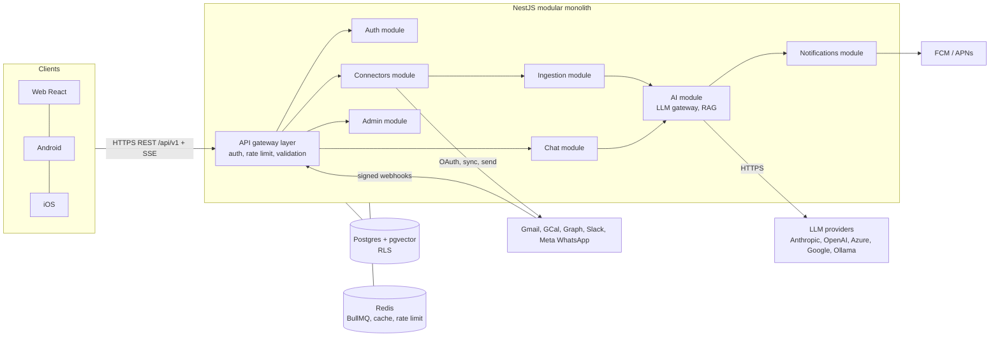
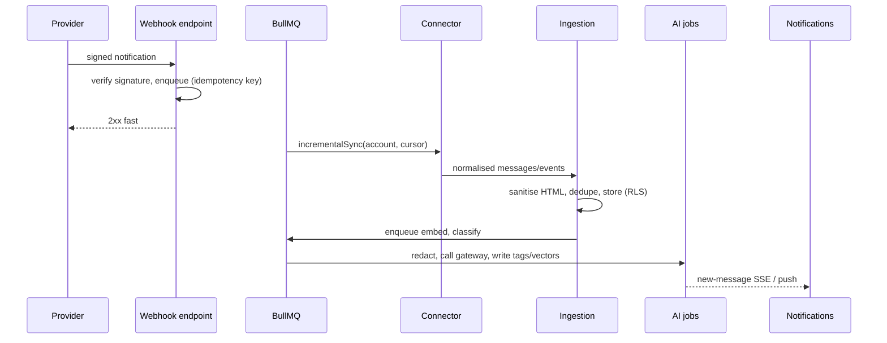
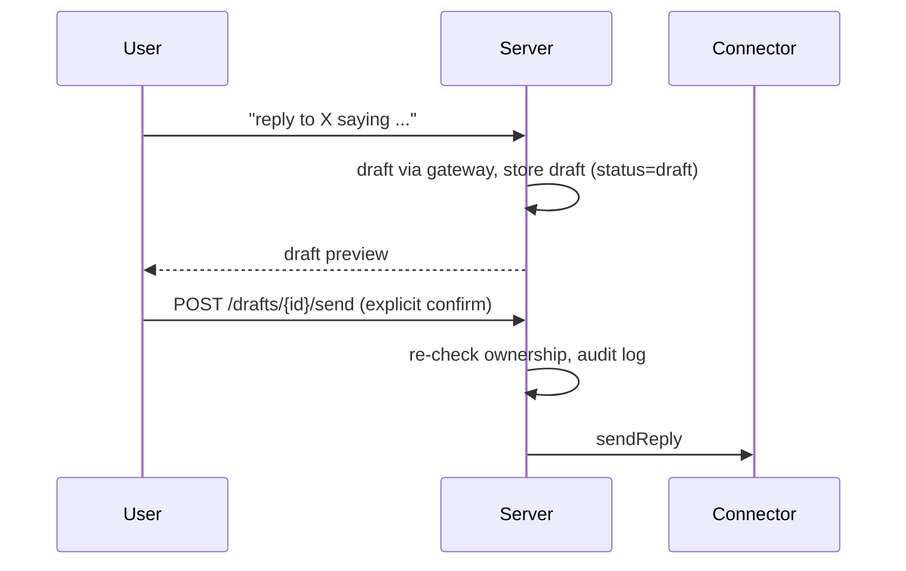

# 01 Architecture

## Components

## Module boundaries
Each module exposes a typed service interface and owns its tables. No cross-module table access; modules talk through services or events (in-process event bus, replaceable by a queue).

| Module | Owns |
|---|---|
| Auth | users, tenants, memberships, sessions, OIDC/JWT, roles |
| Connectors | connected_accounts, channel plugins, sync cursors, subscriptions |
| Ingestion | messages, threads, events, normalisation, dedupe, sanitisation |
| AI | embeddings, tags, summaries, digests, prompt templates, LLM gateway |
| Chat | conversations, turns, citations, drafts |
| Notifications | device tokens, preferences, SSE hub |
| Admin | LLM provider config, quotas, audit viewer |

## Flow: ingestion

Failures retry with backoff and land in a dead-letter queue. Polling backstops missed webhooks.

## Flow: RAG chat
1. Client posts a question and opens the SSE stream.
2. Server sets `app.user_id` for the transaction, so RLS scopes every query.
3. Hybrid retrieval: pgvector similarity plus Postgres full-text, merged by reciprocal rank fusion, limited to the user's allowed channels (AI-off channels excluded).
4. Context is redacted per policy, then sent through the gateway (`chat` route).
5. Tokens stream back; citations (message ids) are attached and linked in the client.

## Flow: reply (never auto-send)

There is no code path that sends without a confirm call from an authenticated user session. The audit log records every send.

## Auth and tenancy
- OIDC login (email, Google, Microsoft), short-lived JWT access tokens, rotating refresh tokens bound to device sessions.
- Roles: `admin` (platform), `tenant_admin`, `user`.
- Every row carries `tenant_id` and (where personal) `user_id`; RLS enforces both.
