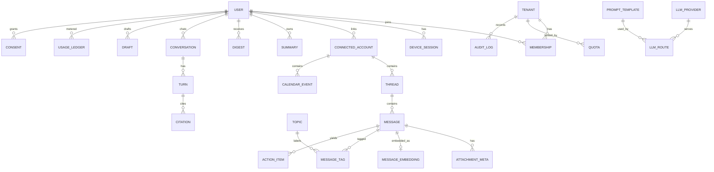

# 02 Data model

## Key tables (columns abridged)
- **tenant**(id, name, kind[personal|org], retention_days, ai_enabled)
- **user**(id, email, locale, settings jsonb, role)
- **membership**(tenant_id, user_id, role[tenant_admin|user])
- **device_session**(id, user_id, refresh_hash, device_name, push_token, last_seen)
- **connected_account**(id, tenant_id, user_id, channel, external_id, status[active|paused|reauth|revoked], enc_tokens bytea, dek_wrapped bytea, scopes[], sync_cursor, backfill_days, ai_enabled, subscription_expiry)
- **thread**(id, account_id, external_id, subject, last_message_at)
- **message**(id, tenant_id, user_id, channel, account_id, thread_id, sender, recipients jsonb, subject, body_text, body_html_sanitized, timestamp, direction, is_read, raw_ref, tsv tsvector; unique(account_id, external_id))
- **attachment_meta**(message_id, name, mime, size, external_ref). Content is not stored by default.
- **message_embedding**(message_id, model, dim, embedding vector)
- **topic**(id, user_id, name), **message_tag**(message_id, topic_id, priority[urgent|needs_reply|fyi|low]), **action_item**(message_id, text, due_at, status)
- **calendar_event**(id, account_id, title, start, end, timezone, organizer, attendees jsonb, location, meeting_link, status, source)
- **summary**(id, user_id, scope[thread|channel|topic], ref_id, text, model, prompt_version), **digest**(id, user_id, period, text)
- **conversation / turn / citation**: chat history with message citations
- **draft**(id, user_id, source_message_id, channel, body, status[draft|sent|discarded], confirmed_at)
- **llm_provider**(id, kind, base_url, enc_api_key, enabled), **llm_route**(task, provider_id, model, temperature, max_tokens, fallback_route_id)
- **prompt_template**(id, task, version, body, active)
- **quota**(scope, tokens_per_day, requests_per_min), **usage_ledger**(user_id, task, model, tokens_in, tokens_out, cost, at)
- **consent**(user_id, purpose, granted_at, withdrawn_at), **audit_log**(id, tenant_id, actor, action, target, at, meta)

## Row-level security
- App connects as a non-superuser role without `BYPASSRLS`.
- Each request transaction runs `SELECT set_config('app.user_id', $1, true), set_config('app.tenant_id', $2, true)`.
- Policy on personal tables: `USING (user_id = current_setting('app.user_id')::uuid)`; tenant tables also check `tenant_id`.
- Background workers set the same GUCs per job. A separate, audited admin role handles platform admin and retention jobs.
- Hard delete: disconnecting an account with "delete data" cascades through messages, embeddings, tags, summaries.
